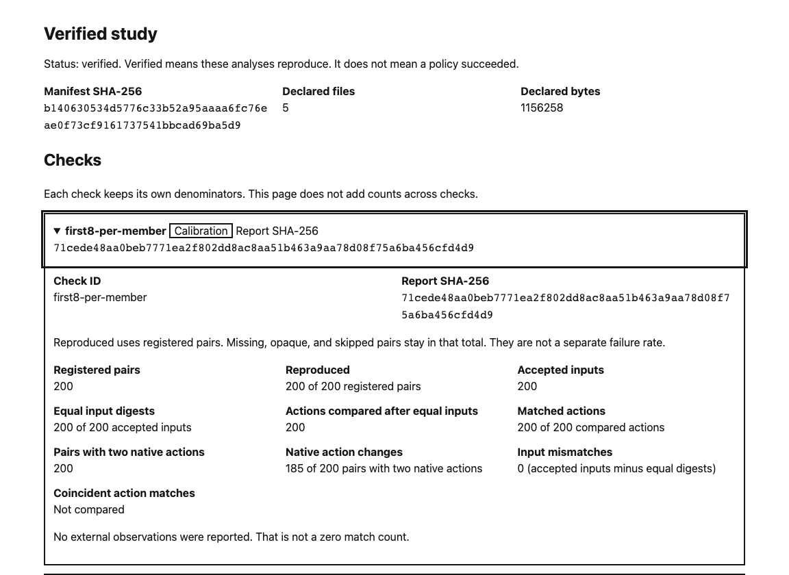

# Try SeatLab on real team decisions

A team can earn the same score after its members make different decisions. SeatLab shows where their recorded inputs or actions first differ. It can also check whether a context change predicts a decision in a separate native run. Harbor remains responsible for running the world and scoring the team.

## Start without Docker or an API key

Open the [live gallery](https://petermakhnatch.github.io/harbor-seatlab/) in a browser. The PettingZoo report compares real team runs across policies, languages and operating systems. The [calendar report](https://petermakhnatch.github.io/harbor-seatlab/calendar.html) tests a smaller view on 200 cases. Expand `first8-per-member`, then compare it with the unchanged-input control. Each section names its own denominator.

For offline use, download the [PettingZoo report](https://github.com/PeterMakhnatch/harbor-seatlab/releases/download/v0.10.0/pettingzoo.html), [calendar report](https://github.com/PeterMakhnatch/harbor-seatlab/releases/download/v0.10.0/calendar.html), or [Hanabi and kitchen report](https://github.com/PeterMakhnatch/harbor-seatlab/releases/download/v0.10.0/team.html). Open the file in your browser. It needs no server or network connection.



To check the numbers yourself, use Python 3.11 or later. The expected digest below pins the study, not the screenshot or HTML.

```sh
work=$(mktemp -d)
python3 -m venv "$work/venv"
releases=https://github.com/PeterMakhnatch/harbor-seatlab/releases/download
"$work/venv/bin/python" -m pip install --no-deps \
  "$releases/v0.10.0/harbor_seatlab-0.10.0-py3-none-any.whl"
curl -fsSL "$releases/v0.8.0/native-calendar-200.tar.gz" -o "$work/data.tar.gz"
(cd "$work" && echo '5717b49b4a0f52a7e8624ef60ae94f6d4d789173e0088d6cba202a549964a9fc  data.tar.gz' | shasum -a 256 -c -)
tar -xzf "$work/data.tar.gz" -C "$work"
"$work/venv/bin/seatlab" study verify "$work/study.json" \
  --expect-sha256 b140630534d5776c33b52a95aaaa6fc76eae0f73cf9161737541bbcad69ba5d9 \
  --html "$work/report.html"
```

## What each result establishes

- **A context change:** The [calendar study](https://github.com/PeterMakhnatch/harbor-multiagent/blob/b5f7a33511775604f9507e64acb37f11e23bbcab/adapters/masbench-scheduling/cohort-results.md) covers 200 published cases. Limiting each of 5 participants to 8 reported times reduces correct team choices from 200 to 15. The source-only prediction reproduces all 200 target choices, including 185 deliberate nulls. Reproducing an action does not mean it was useful.
- **A partner change:** In the [Hanabi study](https://github.com/PeterMakhnatch/harbor-multiagent/blob/1f9da5ecb0267e25d60bc034404a4601902f7504/adapters/hanabi-crossplay/results.md), 7 of 8 matched decks score zero with every team. The decision histories still differ. Compare them in world order, not by the time files arrive. The data concern 2 scripted conventions, not the general strength of a model.
- **A job identity:** The [stock Eval Lab bridge](https://github.com/PeterMakhnatch/harbor-multiagent/blob/5da42e965f2f8f491badfa3009bac5ab9f1c8a6a/examples/seatlab/receipt-job-results.md) joins 4 participant executions to 2 trials and 1 real job. It retains 2 shared rewards. It does not count the reward once per participant or turn unknown tokens into zero.

## Use your own task

Start with the [native receipt board](../examples/receipt-board/). Capture one complete role view and its accepted action. Give a policy author [only the actor views](parallel-replay.md). Give the analyst the native comparison run and its recorded world order. These roles can work independently. Use a fresh native run when a changed action can affect future behavior. An offline report cannot establish what a live partner would do next.
